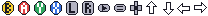

# Reusable artwork

These source assets are optional artwork for games to copy and customize. They
are not linked into `zgdk.lib` or loaded automatically. Artwork is covered by
the repository's [Apache 2.0 license](../LICENSE).

## SNES pad glyphs

[`snes-pad.gif`](snes-pad.gif) is an indexed GIF, 208 × 16 pixels: thirteen
16 × 16 tiles in one horizontal row, ordered left to right:

| Tile | Glyph |
| --- | --- |
| 0 | B |
| 1 | A |
| 2 | Y |
| 3 | X |
| 4 | L |
| 5 | R |
| 6 | Start (triangle button) |
| 7 | Select (two-line button) |
| 8 | D-pad |
| 9 | Up |
| 10 | Down |
| 11 | Left |
| 12 | Right |

Palette index **0 is magenta (`#FF00FF`) and transparent**, with explicit GIF
transparency metadata. Magenta identifies the transparent palette entry in image
editors; it does not render as a background.
The other seven colors are opaque and can be recolored. The palette indices
are source-art indices; remap them into the game's own palette when importing.

Copy the sheet into the game's assets and merge the desired glyphs into its
runtime tileset. Preserve transparency for transparent text, or replace the
transparent pixels with the font's background index for an opaque text row.
The game chooses tile IDs, colors and the ASCII characters used for icons.
Map those characters with `ascii_map()` to use them in either sprite or tilemap
[HUD text](../docs/Hud.md).

Only the merged tileset needs to ship. Keeping a local source sheet is useful
for editing and regeneration, and lets a game build without depending on the
SDK's artwork folder layout.
